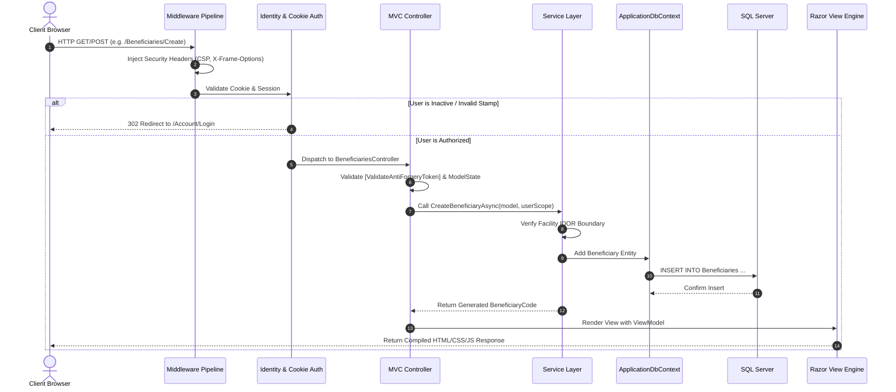
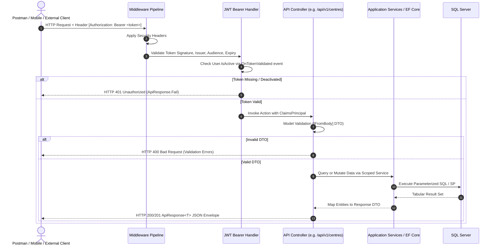
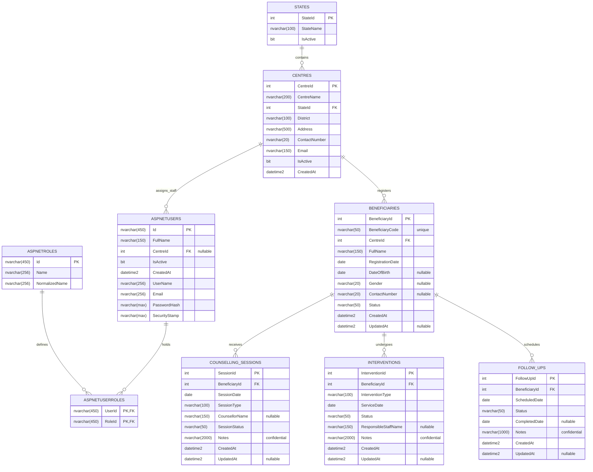

# System Architecture, Request Flows and Entity-Relationship Diagram

**Project:** Centralised Nasha Mukti Database (INT402)  
**Author:** KrChiranjeevi  
**Framework:** ASP.NET Core 8.0 MVC & Web API  
**Database:** Microsoft SQL Server 2022 / Azure SQL  

---

## 1. System Architecture Overview

The Centralised Nasha Mukti Database is architected following an enterprise N-Tier / Clean Architecture design pattern with clear separation of concerns:

```
+-----------------------------------------------------------------------------------+
|                                Presentation Layer                                 |
|  +---------------------------------------------+  +----------------------------+  |
|  |           ASP.NET Core MVC (Razor)          |  |  RESTful Web API (v1 DTOs) |  |
|  |   Views, ViewModels, TagHelpers, Bootstrap  |  |    Swagger OpenAPI 3.0     |  |
|  +---------------------------------------------+  +----------------------------+  |
+------------------------------------------+----------------------------------------+
                                           |
                                           v
+-----------------------------------------------------------------------------------+
|                         Cross-Cutting Security & Middleware                       |
|   Security Headers | Anti-Forgery (CSRF) | Cookie Auth | JWT Bearer | Auditing    |
+------------------------------------------+----------------------------------------+
                                           |
                                           v
+-----------------------------------------------------------------------------------+
|                                Application Service Layer                          |
|  +-------------------------+  +-------------------------+  +-------------------+  |
|  | ICentreService          |  | IBeneficiaryService     |  | ICounsellingSvc   |  |
|  +-------------------------+  +-------------------------+  +-------------------+  |
|  | IInterventionService    |  | IFollowUpService        |  | IReportService    |  |
|  +-------------------------+  +-------------------------+  +-------------------+  |
|  | ICentreAuthService (Scoping & IDOR Isolation)        |  | ITokenService     |  |
|  +------------------------------------------------------+  +-------------------+  |
+------------------------------------------+----------------------------------------+
                                           |
                                           v
+-----------------------------------------------------------------------------------+
|                          Data Access Layer (ORM)                                  |
|                 Entity Framework Core 8.0 (ApplicationDbContext)                  |
|    Code-First Mappings, LINQ to Entities, AsNoTracking, Change Tracker, UnitOfWork|
+------------------------------------------+----------------------------------------+
                                           |
                                           v
+-----------------------------------------------------------------------------------+
|                           Relational Database Layer                               |
|                         Microsoft SQL Server 2022                                 |
|  +--------------------+  +--------------------+  +------------------------------+ |
|  | Relational Tables  |  | Foreign Key Checks |  | SQL Views & Stored Procedures| |
|  +--------------------+  +--------------------+  +------------------------------+ |
+-----------------------------------------------------------------------------------+
```

---

## 2. Request Processing Flows

### A. MVC Request Flow (Server-Side Razor Views)



### B. Web API Request Flow (RESTful JSON Services)



---

## 3. Entity-Relationship (ER) Diagram

The ER Diagram accurately reflects the physical database schema, foreign keys, and cardinalities implemented in `ApplicationDbContext.cs`:



---

## 4. Entity Framework Core Data Access Design

### A. Fluent API Configuration
All relationships and schema rules are explicitly configured using Fluent API in `Data/ApplicationDbContext.cs`:
1. **Cascade Delete Restriction:** All clinical foreign keys specify `.OnDelete(DeleteBehavior.Restrict)`. This guarantees that if a centre or patient record is deactivated, child clinical records (counselling sessions, interventions, and follow-ups) can never be accidentally cascade-deleted from the database.
2. **Unique Constraints & Performance Indexes:**
   - `UQ_Beneficiaries_BeneficiaryCode`: Unique index guaranteeing code uniqueness nationwide.
   - Compound indexes: `IX_Centres_StateId`, `IX_Centres_District`, `IX_Beneficiaries_CentreId`, `IX_Beneficiaries_Status`, `IX_CounsellingSessions_BeneficiaryId`, `IX_Interventions_BeneficiaryId`, `IX_FollowUps_BeneficiaryId`.
3. **Database Defaults:** `CreatedAt` columns utilize `GETUTCDATE()`.

### B. Read Query Optimization (`AsNoTracking`)
Read-only queries throughout MVC services and Web API controllers utilize `.AsNoTracking()` to eliminate the EF Core change tracker overhead, drastically decreasing memory allocation and boosting query throughput.

---

## 5. Centre-Level Access Control & IDOR Prevention

### Problem Definition (Insecure Direct Object Reference - CWE-639)
In a multi-facility healthcare system, a standard vulnerability arises when a counsellor logged into Centre A attempts to view or modify records belonging to Centre B by tampering with the route parameter (e.g. `GET /Beneficiaries/Details/501` or `PUT /api/v1/beneficiaries/501`).

### Architectural Solution (`ICentreAuthorizationService`)
The application implements an authorization gateway service injected into all controllers:

```csharp
public interface ICentreAuthorizationService
{
    Task<bool> IsAdminAsync(ClaimsPrincipal principal);
    Task<int?> GetUserCentreIdAsync(ClaimsPrincipal principal);
    Task<bool> CanAccessCentreAsync(ClaimsPrincipal principal, int centreId);
    Task<bool> CanAccessBeneficiaryAsync(ClaimsPrincipal principal, int beneficiaryId);
    Task<ApplicationUser?> GetCurrentUserAsync(ClaimsPrincipal principal);
}
```

### Authorization Rules:
1. **National Administrator (`Admin`):** Has universal read and write access across all states, facilities, and patients nationwide.
2. **Centre Staff (`CentreStaff`):**
   - Bound strictly to `user.CentreId`.
   - In intake forms (`Create`), the `model.CentreId` submitted from the browser is unconditionally overwritten on the server with `user.CentreId`.
   - In detail, edit, and API actions, `CanAccessBeneficiaryAsync` verifies that `beneficiary.CentreId == user.CentreId`.
   - If unauthorized, the request immediately terminates with HTTP `403 Forbidden` or redirects to `AccessDenied`.

