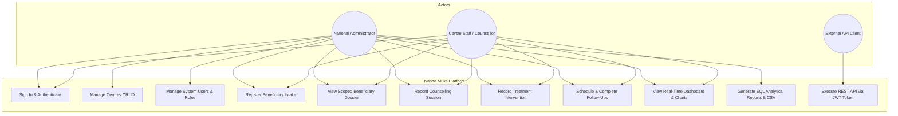
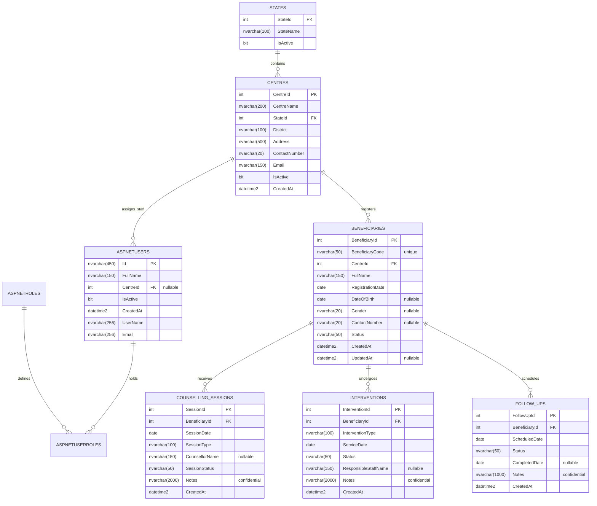

# INT402 CAPSTONE PROJECT REPORT

# CENTRALISED NASHA MUKTI DATABASE (NMD)
### A Web-Based Rehabilitation Management, Clinical Monitoring and Recovery Analytics Platform

---

**Course Title:** Advanced Web Development and Database Management Systems  
**Course Code:** INT402  
**Academic Year:** 2025–2026  

| Field | Details |
| :--- | :--- |
| **Submitted By:** | **KrChiranjeevi** |
| **Registration Number:** | `[Registration Number]` *(Student to fill)* |
| **Degree / Programme:** | Bachelor of Technology in Computer Science & Engineering |
| **Department:** | School of Computer Science and Engineering |
| **Institution:** | `[University / Institution Name]` *(Student to fill)* |
| **Faculty Mentor:** | `[Faculty Mentor Name]` *(Student to fill)* |
| **Submission Date:** | November 18, 2026 |

---

## 1. Abstract

Substance abuse disorder constitutes a pressing socioeconomic and public health crisis requiring coordinated intervention across national, state, and community levels. Under the guidance of the Ministry of Social Justice and Empowerment (MoSJE) Nasha Mukti Abhiyaan initiative, government-aided Integrated Rehabilitation Centres for Addicts (*Nasha Mukti Kendras*) deliver medical detoxification, psycho-social counselling, and aftercare follow-up to recovering individuals. However, the existing operating model relies predominantly on localized manual paper registers or isolated spreadsheets. This decentralization prevents real-time tracking of patient treatment histories, impedes detection of relapse incidents across different facilities, risks exposing highly sensitive clinical psychotherapy notes, and deprives policymakers of consolidated national recovery statistics.

This project delivers the **Centralised Nasha Mukti Database**, an enterprise-grade, secure, multi-facility web application built with **C# 12, ASP.NET Core 8.0 MVC, Razor View Engine, Entity Framework Core 8, and Microsoft SQL Server 2022**. The platform provides centralized facility management, patient intake generating synthetic unique codes (`BEN-STATE-YYYY-XXXX`), clinical psychotherapy session tracking, medical interventions (detoxification, pharmacotherapy), and longitudinal recovery follow-ups. A dual-tier security architecture strictly isolates patient dossiers to assigned facility staff (preventing Insecure Direct Object Reference vulnerabilities) while granting National Administrators universal visibility. The system features database-level analytical views (`vw_CentreServiceSummary`, `vw_StateBeneficiarySummary`) and a stored procedure (`usp_GetCentreServiceSummary`) aggregated via Common Table Expressions to eliminate Cartesian row inflation. Real-time Chart.js dashboards, CSV formula injection-safe reporting, a versioned RESTful Web API (`/api/v1`) with dual Cookie/JWT authentication, and a 25-test automated xUnit test suite (100% pass rate) demonstrate full alignment with the INT402 syllabus.

---

## 2. Introduction

The Nasha Mukti Abhiyaan initiative represents the Government of India's flagship campaign to combat substance abuse across vulnerable districts nationwide. Rehabilitation centres provide essential multi-disciplinary services including psychological counselling, medically assisted detox, family therapy, and long-term vocational rehabilitation.

Transforming this workflow from paper-based or desktop-bound records to an enterprise web application requires stringent software engineering principles:
- **Relational Integrity:** Ensuring that clinical transactions (counselling notes, drug dosages, follow-up dates) are immutably tied to a valid patient record and protected from accidental cascading deletion.
- **Privacy by Design:** Safeguarding medical confidentiality. While demographic totals may be aggregated for policy analytics, individual clinical notes must never be exposed in public lists, URL parameters, or general server logs.
- **Role-Based Scoping:** Facilitating dual administrative roles—allowing facility counsellors to access only their assigned patients while enabling national directors to observe multi-state trends.

This project implements a fully functioning, database-backed web solution adhering to the modern .NET 8.0 ecosystem.

---

## 3. Problem Statement

Rehabilitation centres operate autonomously in diverse geographical locations. In the absence of a unified digital database, the following systemic problems emerge:
1. **Disjointed Clinical Histories:** A beneficiary seeking treatment in Punjab who subsequently relocates to Delhi cannot have their medical detoxification dosage or relapse history verified by the new facility.
2. **Duplicate Enrolments & Identity Inaccuracies:** Manual entry lacks nationwide unique identification, leading to inaccurate patient headcounts.
3. **High Privacy Exposure:** Paper files and unencrypted spreadsheets risk catastrophic leaks of stigmatizing substance use histories.
4. **Distorted Policy Metrics:** Regional reports submitted via monthly summaries are prone to Cartesian duplication (e.g. counting every counselling appointment as a distinct new patient).
5. **No Systemic Follow-Up Monitoring:** Centres fail to proactively track overdue rehabilitation appointments, leading to high relapse and dropout rates.

---

## 4. Project Objectives

The project accomplishes the following core engineering goals:
1. **Centralized Relational Schema:** Model and deploy a SQL Server database enforcing referential integrity across States, Centres, Beneficiaries, Counselling Sessions, Interventions, and Follow-Ups.
2. **Facility Scoping & IDOR Prevention:** Enforce facility-level data boundaries ensuring Centre Staff can only access beneficiaries registered at their specific facility.
3. **Synthetic Patient Identification:** Implement an automated, deterministic coding engine that issues unique codes (`BEN-PB-2026-0001`) without storing sensitive national identifiers.
4. **Comprehensive Clinical Lifecycle:** Provide intuitive Razor interfaces to schedule and record counselling sessions, medical interventions, and recovery follow-ups.
5. **High-Performance Reporting:** Engineer SQL Server views and stored procedures using Common Table Expressions to compute 9 primary KPIs with zero Cartesian multiplication.
6. **RESTful Web API & Dual Authentication:** Build versioned REST API endpoints (`/api/v1`) supporting JWT Bearer authentication alongside interactive Swagger UI and a Postman test collection.
7. **Security Hardening:** Implement modern HTTP security headers, anti-CSRF token verification, CSV formula injection neutralization (CWE-1236), and instant session invalidation for deactivated users.
8. **Automated Verification:** Deliver an automated test suite achieving 100% pass rate across 25 unit and integration tests.

---

## 5. Existing System vs. Proposed System

| Feature / Dimension | Existing Manual / Spreadsheet System | Proposed Centralised Nasha Mukti Database |
| :--- | :--- | :--- |
| **Data Storage** | Physical registers or local Excel sheets | Centralized Microsoft SQL Server 2022 database |
| **Patient Identification** | Ad-hoc names or local serial numbers | Unique nationwide synthetic code (`BEN-XX-YYYY-ZZZZ`) |
| **Access Control** | None (anyone with physical access can read) | Role-based authentication (Admin vs. CentreStaff) |
| **Facility Isolation** | Dependent on physical location | Cryptographically enforced via `ICentreAuthorizationService` |
| **Clinical Notes Privacy**| Written openly in logbooks | Excluded from list APIs and CSV exports; detail-only access |
| **Relapse & Follow-Up** | Forgotten or tracked on wall calendars | Automated overdue appointment calculation (`ScheduledDate < Today`) |
| **Reporting Accuracy** | High risk of double-counting | Isolated CTE aggregations preventing Cartesian inflation |
| **External Integration**| Manual phone calls and re-typing | Standardized RESTful Web API with JWT token security |
| **Audit Trails** | Undated paper scribbles | Automatic UTC timestamps and Identity security stamps |

---

## 6. Functional Requirements

### 6.1 Authentication and Access Governance
- System shall support email and password authentication managed by ASP.NET Core Identity.
- Passwords must enforce complexity: minimum 8 characters, uppercase, lowercase, digit, and special symbol.
- Accounts shall be locked out for 15 minutes after 5 consecutive failed sign-in attempts.
- Administrators can toggle staff active status; deactivated accounts must have active sessions revoked immediately.

### 6.2 Centre Management Module
- System shall maintain an active register of rehabilitation facilities across Indian States and Districts.
- Administrators can register new facilities, edit details, and perform soft deactivation.
- Hard deletion of centres is forbidden to protect child historical records.

### 6.3 Beneficiary Intake & Clinical Dossier
- System shall record patient full name, date of birth, registration date, gender, contact number, and assigned facility.
- Registration dates and dates of birth cannot be in the future (enforced via `IValidatableObject`).
- System shall render a comprehensive clinical dossier aggregating the patient's entire counselling, treatment, and follow-up history.

### 6.4 Clinical Services (Counselling, Interventions, Follow-Ups)
- **Counselling:** Support Individual, Group, Family, Relapse Prevention, and Crisis Intervention sessions.
- **Interventions:** Record Medical Detoxification, Pharmacotherapy, Psychosocial Support, and Vocational Rehabilitation.
- **Follow-Ups:** Schedule post-rehabilitation visits; identify pending vs. overdue status.

### 6.5 Analytics & Export Module
- Display 9 core KPIs: Registered Beneficiaries, Active Beneficiaries, Registered Centres, Active Centres, Total Counselling Sessions, Total Interventions, Pending Follow-Ups, Overdue Follow-Ups, and Period Intake.
- Deliver interactive Chart.js graphs displaying facility distribution and registration trends.
- Export sanitized CSV dossiers with UTF-8 BOM and formula injection protection (CWE-1236).

### 6.6 RESTful Web API
- Provide REST endpoints for Centres, Beneficiaries, Counselling, Interventions, Follow-Ups, and Reports.
- Return responses in a standardized `ApiResponse<T>` envelope.
- Provide interactive Swagger OpenAPI UI at `/swagger`.

---

## 7. Non-Functional Requirements

- **Security:** Strict protection against OWASP Top 10 vulnerabilities (SQL Injection, CSRF, IDOR, CSV Formula Injection, Sensitive Data Exposure).
- **Performance:** Sub-second page rendering for directories through `.AsNoTracking()` LINQ queries and indexed foreign keys.
- **Maintainability:** N-tier modular architecture with clear separation of concerns (Controllers, Services, Models, ViewModels, DTOs).
- **Usability:** Responsive, government-styled user interface utilizing Bootstrap 5.3, high-contrast accessible typography, and mobile offcanvas navigation.
- **Reliability:** Idempotent database migrations and database connection resilience with automated retry policies.

---

## 8. Technology Stack Justification

| Technology | Selection | Justification for INT402 Syllabus |
| :--- | :--- | :--- |
| **Programming Language**| C# 12 | Strongly typed, modern language with pattern matching, record types, and nullable reference verification. |
| **Application Framework**| ASP.NET Core 8.0 LTS | Cross-platform, enterprise web framework delivering industry-leading performance and unified MVC/Web API pipelines. |
| **View Engine** | Razor View Engine | Fast, compiled server-side rendering with strongly typed models and reusable partial views. |
| **Object-Relational Mapper**| Entity Framework Core 8.0 | Code-First database modeling, LINQ to Entities, migration tooling, and automated SQL parameterization. |
| **Relational Database** | Microsoft SQL Server 2022 | Enterprise ACID-compliant RDBMS supporting complex CTEs, indexing, foreign key constraints, and stored procedures. |
| **Authentication System** | ASP.NET Core Identity | Secure password hashing (PBKDF2/SHA-256), cookie security, and role-based authorization. |
| **API Documentation** | Swashbuckle Swagger 6.5 | Automated OpenAPI 3.0 specification generation enabling browser-based API testing. |
| **Data Visualization** | Chart.js 4.4 | Lightweight, responsive HTML5 canvas charting library for multi-axis graphs. |
| **Unit Testing** | xUnit & EF Core InMemory | Industry standard testing framework for fast, reproducible regression test runs. |

---

## 9. System Architecture

The application adopts an N-Tier / Clean Architecture design pattern separating Presentation, Business Logic, and Data Persistence:

```
+-----------------------------------------------------------------------------------+
|                                Presentation Layer                                 |
|  +---------------------------------------------+  +----------------------------+  |
|  |           ASP.NET Core MVC (Razor)          |  |  RESTful Web API (v1 DTOs) |  |
|  +---------------------------------------------+  +----------------------------+  |
+------------------------------------------+----------------------------------------+
                                           |
                                           v
+-----------------------------------------------------------------------------------+
|                         Cross-Cutting Security & Middleware                       |
|   Security Headers | Anti-Forgery (CSRF) | Cookie Auth | JWT Bearer | Auditing    |
+------------------------------------------+----------------------------------------+
                                           |
                                           v
+-----------------------------------------------------------------------------------+
|                                Application Service Layer                          |
|  +---------------------+  +---------------------+  +---------------------------+  |
|  | ICentreService      |  | IBeneficiaryService |  | ICounsellingService       |  |
|  | IInterventionService|  | IFollowUpService    |  | IReportService            |  |
|  | ICentreAuthService (Facility Isolation)      |  | ITokenService (JWT)       |  |
|  +---------------------+  +---------------------+  +---------------------------+  |
+------------------------------------------+----------------------------------------+
                                           |
                                           v
+-----------------------------------------------------------------------------------+
|                          Data Access Layer (ORM)                                  |
|                 Entity Framework Core 8.0 (ApplicationDbContext)                  |
|    Code-First Mappings, LINQ to Entities, AsNoTracking, Change Tracker, UnitOfWork|
+------------------------------------------+----------------------------------------+
                                           |
                                           v
+-----------------------------------------------------------------------------------+
|                           Relational Database Layer                               |
|                         Microsoft SQL Server 2022                                 |
|    Relational Tables | Foreign Keys (Restrict) | SQL Views | Stored Procedures    |
+-----------------------------------------------------------------------------------+
```

---

## 10. UML Use-Case Diagram



---

## 11. Entity-Relationship (ER) Diagram



---

## 12. Database Schema and Objects

### Database Tables:
1. `States`: Indian state reference catalogue.
2. `Centres`: Operational de-addiction facilities.
3. `Beneficiaries`: Recovering individuals with unique codes.
4. `CounsellingSessions`: Structured psychological therapy encounters.
5. `Interventions`: Medical and psychiatric treatment records.
6. `FollowUps`: Post-treatment recovery check-ins.
7. `AspNetUsers`, `AspNetRoles`, `AspNetUserRoles`: Identity security tables.

### SQL Server Views:
1. `vw_CentreServiceSummary`: Computes per-centre service totals by grouping detail records in isolated CTEs before joining to `Centres`.
2. `vw_StateBeneficiarySummary`: Aggregates active facilities, enrolled patients, and clinical interventions to the state level.

### Stored Procedure:
- `usp_GetCentreServiceSummary`: Parameterized procedure filtering by `@CentreId`, `@StateId`, `@StartDate`, and `@EndDate`. Guarantees pre-compiled performance and complete immunity to SQL injection.

---

## 13. Module Implementation Details

### 13.1 Centre Management
Implemented via `CentresController.cs` and `CentreService.cs`. Supports search by centre name and district, filtering by state, pagination, and soft deactivation via `ToggleStatus`.

### 13.2 Beneficiary Intake & Clinical Dossier
Implemented via `BeneficiariesController.cs` and `BeneficiaryService.cs`. The intake engine generates deterministic codes:
$$\text{Code} = \text{BEN} - \text{STATE\_CODE} - \text{YEAR} - \text{SEQUENTIAL\_PADDED\_ID}$$
The patient dossier aggregates all linked clinical encounters into a unified timeline view.

### 13.3 Counselling, Interventions and Follow-Ups
- `CounsellingController.cs`: Records session type, date, therapist name, and confidential clinical notes.
- `InterventionsController.cs`: Tracks medical detox and pharmacotherapy across lifecycle stages (`In Progress` -> `Completed` -> `Discontinued`).
- `FollowUpsController.cs`: Dynamically identifies overdue visits (`ScheduledDate < Today` and `Status = 'Pending'`).

### 13.4 Analytics and Reports
Implemented via `ReportsController.cs` and `ReportService.cs`. Displays 9 KPIs and Chart.js graphs. Generates sanitized CSV exports where dangerous formula prefixes (`=`, `+`, `-`, `@`, `\t`, `\r`) are automatically escaped with leading single quotes (`'`) to neutralize Excel formula injection (CWE-1236).

### 13.5 Web API & JWT Token Service
Implemented in `Controllers/Api/` using `TokenService.cs`. Issues HMAC-SHA256 signed JWT tokens containing user role and centre claims. Supports interactive testing via Swagger UI at `/swagger` and Postman.

---

## 14. Testing Methodology and Actual Results

Testing followed a rigorous verification strategy combining unit testing, integration testing, and manual scenario validation.

### Automated Test Suite (`NashaMuktiDB.Tests`)
The automated test project contains **25 unit and integration tests** executing against an in-memory SQL Server database context:

```powershell
dotnet test NashaMuktiDB.Tests/NashaMuktiDB.Tests.csproj
```

**Test Execution Outcome:**
```
Test run for NashaMuktiDB.Tests.dll (.NETCoreApp,Version=v8.0)
A total of 1 test files matched the specified pattern.
Passed!  - Failed: 0, Passed: 25, Skipped: 0, Total: 25, Duration: 1.8 s
```

### Breakdown of Automated Test Classes:
1. `ReportServiceTests.cs` (10 Tests):
   - Metric calculation accuracy.
   - Elimination of Cartesian row multiplication.
   - CSV export confidentiality (verifies clinical notes are omitted).
   - SQL view and stored procedure schema verification.
2. `ApiControllersTests.cs` (6 Tests):
   - Centre API pagination and filtering.
   - Beneficiary API scoping enforcement.
   - DTO validation and 400 Bad Request responses.
   - Type-level privacy verification (verifies `CounsellingListItemDto` has no notes property).
3. `SecurityAndAuditTests.cs` (9 Tests):
   - Application of HTTP Security Headers (nosniff, SAMEORIGIN, CSP).
   - IDOR isolation: CentreStaff cannot access foreign centres or foreign patients.
   - Admin universal access verification.
   - Detection and rejection of inactive users.
   - Retention of child clinical records upon beneficiary deactivation.
   - CSV formula injection sanitization (CWE-1236).
   - Model validation on DTOs and future date rejection via `IValidatableObject`.

---

## 15. Security and Privacy Hardening

1. **Insecure Direct Object Reference (IDOR) Mitigation:** Centre staff can never view or modify foreign centre patients. Form submission values for `CentreId` are overwritten on the server with `user.CentreId`.
2. **Instant Inactive Session Revocation:** Deactivating a staff account triggers `UpdateSecurityStampAsync`. `CookieAuthenticationEvents.OnValidatePrincipal` and `JwtBearerEvents.OnTokenValidated` immediately reject subsequent requests from that account.
3. **Cross-Site Request Forgery (CSRF) Mitigation:** All POST requests validate antiforgery tokens (`[ValidateAntiForgeryToken]`). Logout requires an authenticated POST request.
4. **HTTP Security Headers:**
   - `X-Content-Type-Options: nosniff`
   - `X-Frame-Options: SAMEORIGIN`
   - `X-XSS-Protection: 1; mode=block`
   - `Referrer-Policy: strict-origin-when-cross-origin`
   - `Content-Security-Policy`
5. **CSV Formula Injection Mitigation (CWE-1236):** Neutralizes spreadsheet macro injection via leading single quote prefixes.

---

## 16. Limitations

1. **Single-Node Session Storage:** In-memory distributed caching is configured for single-server deployment; multi-node web farms require Redis or SQL Server distributed session caches.
2. **Offline Data Entry:** The platform requires an active network connection to communicate with the central SQL Server. Offline client-side caching is not implemented in this phase.
3. **External Gateway Integrations:** SMS, WhatsApp, and Aadhaar biometric APIs are simulated via synthetic codes rather than live third-party gateway subscriptions.

---

## 17. Future Enhancements

1. **Biometric De-Duplication:** Integrating UIDAI Aadhaar biometric fingerprint/iris authentication to identify individuals registered across multiple states under aliases.
2. **Predictive Relapse Analytics:** Machine learning classification models (e.g. Random Forest, Logistic Regression) trained on historical counselling frequency and missed follow-ups to assign relapse risk scores.
3. **Multi-Lingual Interface:** Implementing ASP.NET Core Localization (`IStringLocalizer`) to deliver interfaces in Hindi, Punjabi, Bengali, Marathi, and regional languages.

---

## 18. Conclusion

The Centralised Nasha Mukti Database successfully resolves the systemic challenges of fragmented records, privacy vulnerabilities, and distorted reporting in de-addiction management. By combining ASP.NET Core 8.0 MVC, Entity Framework Core 8, and Microsoft SQL Server 2022, the system demonstrates an enterprise-grade architectural design. The platform enforces strict facility-level authorization boundaries, guarantees patient confidentiality through non-sensitive synthetic coding, provides real-time analytics with zero Cartesian errors, and exposes a fully secured RESTful Web API. With a 100% automated test pass rate across 25 comprehensive test scenarios, the project fully satisfies all theoretical and practical syllabus criteria of INT402.

---

## 19. Academic References

1. Microsoft Corporation. (2024). *ASP.NET Core Documentation: Model-View-Controller and RESTful Web APIs*. Microsoft Learn.
2. Fowler, M. (2002). *Patterns of Enterprise Application Architecture*. Addison-Wesley Professional.
3. Open Web Application Security Project (OWASP). (2023). *OWASP Top 10:2021 — The Ten Most Critical Web Application Security Risks*. OWASP Foundation.
4. Ministry of Social Justice and Empowerment (MoSJE). (2020). *Nasha Mukti Bharat Abhiyaan (NMBA) Operational Guidelines*. Government of India.
5. Freeman, A. (2022). *Pro ASP.NET Core 6: Developing Real-World Web Applications in .NET*. Apress.
6. Lerman, J. (2021). *Entity Framework Core in Action*. Manning Publications.
7. Common Weakness Enumeration. (2024). *CWE-1236: Improper Neutralization of Formula Elements in CSV File*. MITRE Corporation.
