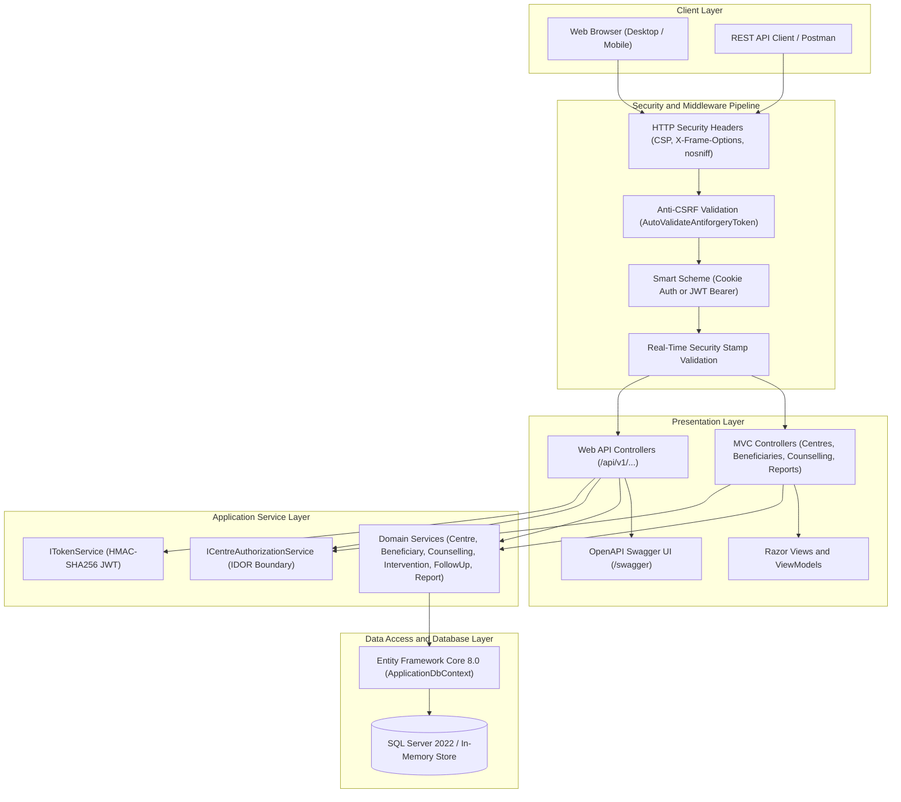
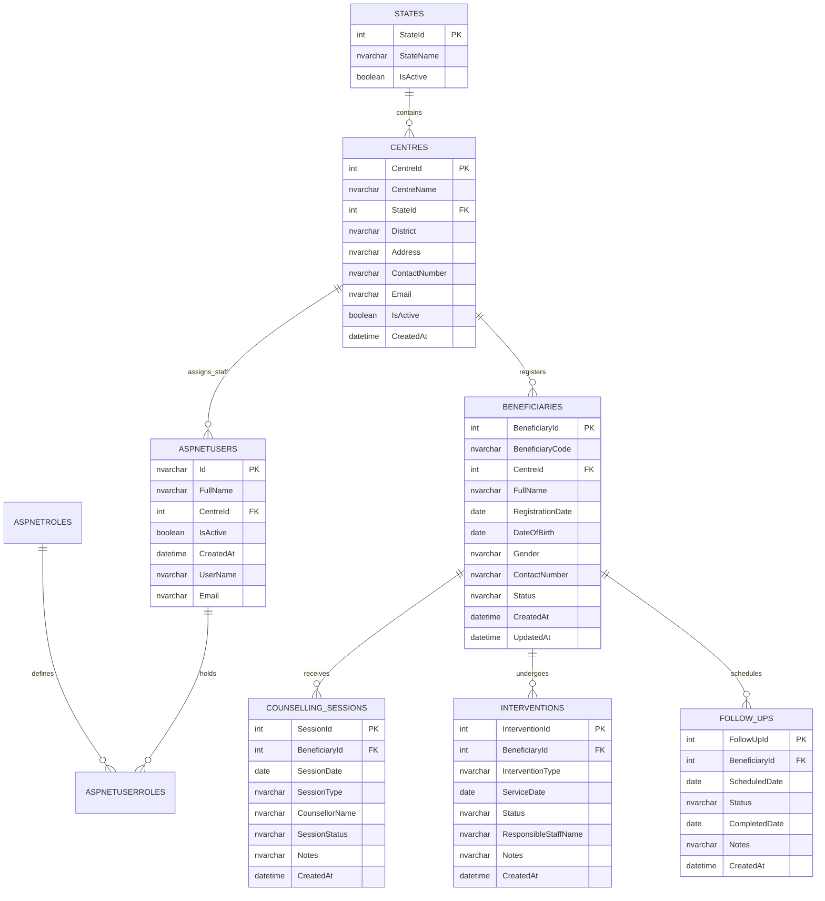

# Centralised Nasha Mukti Database

> **Enterprise De-Addiction Clinical Intake, Rehabilitation Monitoring & Recovery Analytics Platform**  
> *Academic Capstone Project for Course: **INT402** (Advanced Web Development & Database Systems)*

---

[](https://dotnet.microsoft.com/)
[](https://learn.microsoft.com/dotnet/csharp/)
[](https://learn.microsoft.com/aspnet/core/)
[](https://learn.microsoft.com/ef/core/)
[](https://www.microsoft.com/sql-server)
[](https://getbootstrap.com/)
[](https://github.com/KrChiranjeevi/Centralised-Nasha-Mukti-Database)
[](https://github.com/KrChiranjeevi/Centralised-Nasha-Mukti-Database)

---

> [!IMPORTANT]
> **Academic Demonstration Project Disclaimer:**  
> This application is developed solely as an academic capstone demonstration for university course **INT402 (Advanced Web Development & Database Systems)**. It is **not** an official software platform of the Ministry of Social Justice and Empowerment (MoSJE), Government of India, nor is it endorsed, authorized, or operated by any government body. All rehabilitation facilities, staff accounts, beneficiary profiles, counselling sessions, medical encounters, and performance figures are **100% synthetic, fictitious demonstration records** generated exclusively for academic software development, architectural demonstration, and evaluation. No actual protected health information (PHI) or personally identifiable information (PII) is stored or processed.

---

## Table of Contents
- [1. Overview](#1-overview)
- [2. Problem Statement](#2-problem-statement)
- [3. Project Objectives](#3-project-objectives)
- [4. Key Features](#4-key-features)
- [5. Technology Stack](#5-technology-stack)
- [6. System Architecture](#6-system-architecture)
- [7. Database Design & Entity Relationships](#7-database-design--entity-relationships)
- [8. Project Structure](#8-project-structure)
- [9. Prerequisites](#9-prerequisites)
- [10. Installation & Local Setup](#10-installation--local-setup)
- [11. Configuration & Secrets Management](#11-configuration--secrets-management)
- [12. Application Usage Guide](#12-application-usage-guide)
- [13. RESTful Web API & Swagger Documentation](#13-restful-web-api--swagger-documentation)
- [14. Automated Testing & Verification](#14-automated-testing--verification)
- [15. Security, Privacy & Compliance](#15-security-privacy--compliance)
- [16. Troubleshooting & Common Issues](#16-troubleshooting--common-issues)
- [17. Future Enhancements](#17-future-enhancements)
- [18. Academic Information](#18-academic-information)
- [19. License & Credits](#19-license--credits)
- [20. Conclusion](#20-conclusion)

---

## 1. Overview

The **Centralised Nasha Mukti Database (NMD)** is an academic web application designed to demonstrate the digital management and monitoring of de-addiction and rehabilitation centres (*Nasha Mukti Kendras*), structured after the operational domain of public healthcare initiatives.

The platform provides a centralized, multi-tenant-capable system supporting two distinct roles:
1. **National Administrators (`Admin`):** Oversee nationwide facilities across Indian states and union territories, manage staff user credentials, view consolidated service analytics, and export sanitized clinical dossiers.
2. **Facility Counsellors / Staff (`CentreStaff`):** Bound strictly to their assigned rehabilitation facility to register patient intakes, record psychological counselling encounters, track medical detox/pharmacotherapy interventions, and manage follow-up appointments.

Built with **ASP.NET Core 8.0 MVC**, **Entity Framework Core 8**, and **Microsoft SQL Server 2022** (with automated In-Memory database fallback for offline evaluation), the application combines server-rendered Razor interfaces with a versioned, secure RESTful Web API (`/api/v1`) documented via OpenAPI/Swagger.

---

## 2. Problem Statement

Across healthcare and rehabilitation networks, facilities frequently operate in disconnected administrative silos. In the absence of a unified digital platform, operational bottlenecks emerge:
- **Fragmented Medical Histories:** When recovering individuals move between states or facilities, their past interventions and follow-up schedules are unavailable to attending clinicians.
- **Identity Duplication & Headcount Errors:** Manual paper registers cannot reliably prevent individuals from being recorded under different entries across multiple facilities.
- **Exposure of Sensitive Therapy Notes:** Physical registers and unencrypted spreadsheets risk unauthorized exposure of confidential psychotherapy notes and substance use history.
- **High Appointment Drop-Out Rates:** Overdue recovery appointments are difficult to monitor manually, preventing timely staff outreach.
- **Cartesian Duplication in Reporting:** Naive multi-table SQL queries inflate counts by accidentally multiplying patient records against multiple counselling and intervention records.

---

## 3. Project Objectives

The project accomplishes six core engineering objectives aligned with the INT402 curriculum:
1. **Centralised Relational Storage:** Architect and deploy an ACID-compliant SQL Server database enforcing referential integrity across States, Centres, Beneficiaries, Counselling Sessions, Interventions, and Follow-Ups.
2. **Deterministic Synthetic Coding:** Issue unique, non-sensitive patient identifiers (`BEN-<STATE>-YYYY-XXXX`) ensuring privacy by design without storing national identity numbers.
3. **Facility Scoping & IDOR Prevention:** Cryptographically enforce centre boundaries so facility staff can never view or modify records from external centres (preventing Insecure Direct Object Reference vulnerabilities).
4. **End-to-End Clinical Lifecycle:** Track beneficiaries from initial intake through therapy sessions, medical treatments, and longitudinal aftercare follow-ups.
5. **High-Performance Analytics Without Cartesian Errors:** Model SQL Server views (`vw_CentreServiceSummary`, `vw_StateBeneficiarySummary`) and a stored procedure (`usp_GetCentreServiceSummary`) using isolated Common Table Expressions (CTEs).
6. **Dual Authentication & REST Web API:** Deliver a versioned RESTful Web API (`/api/v1`) with JWT Bearer tokens alongside cookie-based MVC authentication, documented interactively via Swagger/OpenAPI.

---

## 4. Key Features

| Module | Core Capabilities | Access Level |
| :--- | :--- | :--- |
| **Authentication & Identity** | Email/Password login, lockout after 5 failed attempts (15 mins), password hashing (PBKDF2), real-time session invalidation on account deactivation. | All Users |
| **Centre Management** | National facility directory, real-time search by facility name and district, state-wise filtering, paginated browsing, and controlled soft deactivation. | Admin Only (Write) / All (Read) |
| **Beneficiary Intake** | Automated code generation (`BEN-PB-2026-0001`), past date-of-birth validation (`IValidatableObject`), gender and contact number capture. | Scoped to Facility |
| **Patient Clinical Dossier** | Comprehensive patient timeline view aggregating all historical counselling sessions, medical treatments, and follow-up records. | Scoped to Facility |
| **Counselling Sessions** | Categorized therapy tracking (Individual, Group, Family, Relapse Prevention). Confidential clinical notes omitted from lists and CSVs for privacy. | Scoped to Facility |
| **Medical Interventions** | Treatment records for Medical Detoxification, Pharmacotherapy, Psychosocial Support, and Vocational Rehabilitation with status transitions. | Scoped to Facility |
| **Recovery Follow-Ups** | Proactive appointment scheduling with dynamic overdue detection (`ScheduledDate < Today & Status = Pending`) and status evaluation. | Scoped to Facility |
| **Reports & Analytics** | 9 KPI metric cards, interactive Chart.js graphs, CTE SQL views, stored procedure execution, and formula injection-safe CSV exports (CWE-1236). | Authenticated Users |
| **RESTful Web API** | Versioned `/api/v1` routes with standardized `ApiResponse<T>` envelopes, JWT Bearer tokens, and interactive Swagger UI at `/swagger`. | JWT Authenticated |

---

## 5. Technology Stack

```
+-----------------------------------------------------------------------------------+
|                                  TECHNOLOGY STACK                                 |
+--------------------+--------------------------------------------------------------+
| Language & Runtime | C# 12.0  |  .NET 8.0 LTS (net8.0)                            |
| Web Framework      | ASP.NET Core 8.0 MVC (Model-View-Controller)                 |
| Web API Framework  | ASP.NET Core Web API with Swashbuckle Swagger OpenAPI 6.5     |
| View Engine        | Razor View Engine (.cshtml) with TagHelpers                  |
| Database Engine    | Microsoft SQL Server 2022 / EF Core In-Memory Fallback       |
| ORM Framework      | Entity Framework Core 8.0.10 (Code-First with Migrations)    |
| Authentication     | ASP.NET Core Identity (Cookie Auth + JWT Bearer Tokens)      |
| Frontend Libraries | Bootstrap 5.3, Bootstrap Icons, Chart.js 4.4, Native ES6 JS  |
| Automated Testing  | xUnit 2.5.3, EF Core InMemory, Microsoft.NET.Test.Sdk       |
| API Testing        | Postman (Collection Included), Swagger UI                    |
+--------------------+--------------------------------------------------------------+
```

---

## 6. System Architecture

The application adopts an **N-Tier Architecture** pattern ensuring separation of concerns between Presentation, Security, Domain Services, and Data Access layers:



---

## 7. Database Design & Entity Relationships

The relational database is configured via Fluent API in `Data/ApplicationDbContext.cs` and deployed through EF Core Code-First migrations.

### Entity-Relationship Diagram (ERD)



### Key Relational Safeguards
- **Cascading Delete Restriction (`DeleteBehavior.Restrict`):** Hard cascade deletion is explicitly forbidden on all clinical foreign keys. When a centre or beneficiary is deactivated, related counselling sessions, treatments, and follow-ups are preserved permanently in the database.
- **Unique Constraint (`UQ_Beneficiaries_BeneficiaryCode`):** Guarantees zero duplicate patient identifiers nationwide.
- **Database-Level Analytical Objects:**
  - `vw_CentreServiceSummary`: Solves Cartesian row explosion by pre-aggregating child tables in isolated CTEs (`BenAgg`, `CounsellingAgg`, `InterventionAgg`, `FollowUpAgg`).
  - `vw_StateBeneficiarySummary`: Rolls up facility and clinical totals to the state level.
  - `usp_GetCentreServiceSummary`: Pre-compiled stored procedure with strongly-typed parameters (`@CentreId`, `@StateId`, `@StartDate`, `@EndDate`), immune to SQL injection.

---

## 8. Project Structure

```
C:\INT402\
├── Controllers/                 # MVC Controllers
│   ├── AccountController.cs     # Authentication, Login, CSRF-hardened Logout
│   ├── AdminController.cs       # User management, role assignment, active toggling
│   ├── BeneficiariesController.cs # Patient intake, dossier, scoping
│   ├── CentresController.cs     # Facility CRUD, search, status toggling
│   ├── CounsellingController.cs # Therapy session recording, note privacy
│   ├── InterventionsController.cs # Medical detox & treatment management
│   ├── FollowUpsController.cs   # Overdue recovery appointment tracking
│   ├── ReportsController.cs     # Analytics, SQL views, CSV export
│   └── DashboardController.cs   # Executive dashboard view
│
├── Controllers/Api/             # RESTful Web API Controllers (/api/v1)
│   ├── AuthController.cs        # JWT authentication endpoint
│   ├── CentresApiController.cs  # Facility REST endpoints
│   ├── BeneficiariesApiController.cs # Patient intake REST endpoints
│   ├── CounsellingApiController.cs # Counselling REST endpoints
│   ├── InterventionsApiController.cs # Interventions REST endpoints
│   ├── FollowUpsApiController.cs # Follow-ups REST endpoints
│   ├── ReportsApiController.cs  # KPI summary REST endpoint
│   └── DashboardApiController.cs # Chart.js data feed
│
├── Data/                        # Data Persistence Layer
│   ├── ApplicationDbContext.cs  # EF Core context & Fluent API mappings
│   ├── DatabaseSeeder.cs        # Environment-aware Identity & data seeder
│   ├── CompleteDatabasePart7.sql# Full offline database creation SQL script
│   └── deploy.sql               # Idempotent EF Core migration script
│
├── DTOs/                        # Web API Data Transfer Objects
├── Migrations/                  # EF Core Code-First C# Migration History
├── Models/                      # Domain Entities (Centre, Beneficiary, etc.)
├── Services/                    # Domain Service Interfaces & Implementations
│   ├── CentreAuthorizationService.cs # IDOR boundary enforcement
│   ├── BeneficiaryService.cs    # Intake & code generation engine
│   ├── ReportService.cs         # KPI math, CTE query runner, safe CSV export
│   └── TokenService.cs          # HMAC-SHA256 JWT generator
│
├── ViewModels/                  # Strongly-typed Razor ViewModels
├── Views/                       # Razor Views & Shared Layouts
├── wwwroot/                     # Static assets (Bootstrap 5.3, site.css, site.js)
├── docs/screenshots/            # Screenshot capture guide and specifications
├── NashaMuktiDB.Tests/          # Automated Test Project (25 xUnit tests)
├── NashaMukti_API_Postman_Collection.json # Postman collection
├── Program.cs                   # Application startup, DI & middleware pipeline
├── appsettings.json             # Development configuration
├── appsettings.Production.json.example # Production configuration template
└── README.md                    # Root project documentation
```

---

## 9. Prerequisites

Verify that the following tools are installed before running the project:

1. **.NET 8.0 SDK (LTS):**
   - Version 8.0.100 or later. Verify via:
     ```powershell
     dotnet --version
     # Expected: 8.0.xxx
     ```
   - Download: [https://dotnet.microsoft.com/download/dotnet/8.0](https://dotnet.microsoft.com/download/dotnet/8.0)
2. **Microsoft SQL Server (Optional for Local Evaluation):**
   - Any edition: SQL Server 2019 / 2022 Express, Developer Edition, LocalDB, or Docker:
     ```bash
     docker run -e "ACCEPT_EULA=Y" -e "MSSQL_SA_PASSWORD=<YOUR_STRONG_PASSWORD>" -p 1433:1433 -d mcr.microsoft.com/mssql/server:2022-latest
     ```
   - *Note:* If local SQL Server is not installed or offline, the application automatically falls back to an **Entity Framework Core In-Memory Database** populated with sample synthetic directory and clinical records.
3. **Entity Framework Core CLI Tool (Optional):**
   ```powershell
   dotnet tool install --global dotnet-ef
   ```
4. **Git:** To clone and inspect the repository.
5. **Postman (Optional):** To execute API test requests using the provided collection.

---

## 10. Installation & Local Setup

### Step 1: Clone Repository
```powershell
git clone https://github.com/KrChiranjeevi/Centralised-Nasha-Mukti-Database.git
cd Centralised-Nasha-Mukti-Database
```

### Step 2: Restore Dependencies & Build
```powershell
dotnet restore
dotnet build
```

### Step 3: Configure Database Connection
Open `appsettings.json` to inspect or customize your database connection string:

- **Local SQL Server (Default / Developer Edition):**
  ```json
  "ConnectionStrings": {
    "DefaultConnection": "Server=localhost;Database=NashaMuktiDB;Trusted_Connection=True;TrustServerCertificate=True;"
  }
  ```
- **LocalDB (Visual Studio Default):**
  ```json
  "ConnectionStrings": {
    "DefaultConnection": "Server=(localdb)\\mssqllocaldb;Database=NashaMuktiDB;Trusted_Connection=True;MultipleActiveResultSets=true;TrustServerCertificate=True"
  }
  ```
- **SQL Server Express:**
  ```json
  "ConnectionStrings": {
    "DefaultConnection": "Server=localhost\\SQLEXPRESS;Database=NashaMuktiDB;Trusted_Connection=True;TrustServerCertificate=True;"
  }
  ```

### Step 4: Run Application
Start the application using the dotnet CLI:
```powershell
dotnet run --urls "http://localhost:5000;http://localhost:5101"
```
The application will automatically detect database availability, apply pending migrations or initialize the in-memory store, and seed the demonstration roles and accounts.

### Step 5: Default Evaluation Credentials (Fictional Demo Data)

The following synthetic demonstration accounts are pre-seeded for local evaluation:

| Account | Email Address | Password | Role | Facility Affiliation |
| :--- | :--- | :--- | :--- | :--- |
| **National Admin** | `admin@nashamukti.gov.in` | `Admin@12345` | **Admin** | *None (Universal Access)* |
| **System Admin** | `admin@nmd.gov.in` | `Admin@NMD2026!` | **Admin** | *None (Universal Access)* |
| **Amritsar Staff** | `staff.amritsar@nmd.gov.in` | `Staff@NMD2026!` | **CentreStaff** | Navchetan Centre, Amritsar (`CentreId = 1`) |
| **Patna Staff** | `staff.patna@nmd.gov.in` | `Staff@NMD2026!` | **CentreStaff** | Disha De-Addiction Kendra, Patna (`CentreId = 3`) |

> *Note:* In production configurations, sample staff accounts are disabled, and administrator credentials must be provided securely via environment variables (`NMD_ADMIN_PASSWORD`).

---

## 11. Configuration & Secrets Management

Development configuration is specified in `appsettings.json`:

```json
{
  "ConnectionStrings": {
    "DefaultConnection": "Server=localhost;Database=NashaMuktiDB;Trusted_Connection=True;TrustServerCertificate=True;"
  },
  "Logging": {
    "LogLevel": {
      "Default": "Information",
      "Microsoft.AspNetCore": "Warning",
      "Microsoft.EntityFrameworkCore": "Warning"
    }
  },
  "AllowedHosts": "*",
  "AppSettings": {
    "SystemName": "Centralised Nasha Mukti Database",
    "Ministry": "Ministry of Social Justice and Empowerment (Academic Demo)",
    "AuditLogEnabled": true,
    "PageSize": 15
  },
  "Jwt": {
    "Key": "NashaMuktiPlatform_SecureJwtSecretKey_2026_AcademicDemoKey99!",
    "Issuer": "NashaMuktiPortal",
    "Audience": "NashaMuktiClients",
    "ExpiryHours": 8
  }
}
```

### Managing Secrets Locally with .NET User Secrets
For local development without committing sensitive values, use the .NET Secret Manager:

```powershell
# Initialize Secret Manager for the project
dotnet user-secrets init

# Set custom development JWT signing key (minimum 64 characters)
dotnet user-secrets set "Jwt:Key" "<YOUR_DEVELOPMENT_64_BYTE_RANDOM_KEY>"

# Set custom database connection string
dotnet user-secrets set "ConnectionStrings:DefaultConnection" "<YOUR_LOCAL_CONNECTION_STRING>"
```

### Setting Production Secrets
In production deployments, secrets must **never** be checked into version control. Supply them through environment variables or a managed cloud vault:

```powershell
# Set production connection string
$env:ConnectionStrings__DefaultConnection = "Server=tcp:<YOUR_SQL_SERVER>.database.windows.net,1433;Initial Catalog=NashaMuktiProdDB;User ID=<ADMIN_USER>;Password=<YOUR_STRONG_PASSWORD>;Encrypt=True;"

# Set 64-character cryptographic JWT signing key
$env:Jwt__Key = "<YOUR_SECURE_64_BYTE_RANDOM_KEY>"

# Set initial administrative account password
$env:Security__DefaultAdminPassword = "<YOUR_STRONG_ADMIN_PASSWORD>"
```
Refer to [appsettings.Production.json.example](appsettings.Production.json.example) for the full sanitized deployment template.

---

## 12. Application Usage Guide

### A. Authentication & Sign In
1. Start the application: `dotnet run --urls "http://localhost:5000;http://localhost:5101"`.
2. Open your web browser and navigate to `http://localhost:5000` (or `http://localhost:5101`).
3. You will be redirected to the secure sign-in interface at `/Account/Login`.
4. Enter `admin@nashamukti.gov.in` and password `Admin@12345` (or `admin@nmd.gov.in` / `Admin@NMD2026!`) to sign in as Administrator.

### B. Core Workflows
1. **Facility Management (`/Centres`):**
   - Click **Centres** in the navigation sidebar to browse the facility directory.
   - Filter by State (Punjab, Bihar, Maharashtra, Rajasthan) or active status.
   - Administrators can register new facilities via **Register New Centre**.
2. **Beneficiary Intake (`/Beneficiaries`):**
   - Click **Beneficiaries** -> **Register Beneficiary**.
   - Input patient name, registration date, date of birth, gender, and contact telephone.
   - The platform auto-generates a synthetic code (e.g., `BEN-PB-2026-0001`).
3. **Clinical Patient Dossier (`/Beneficiaries/Details/{id}`):**
   - View patient demographics and computed age.
   - Access tabbed clinical records: Counselling Sessions, Medical Treatments, and Follow-Up Visits.
4. **Counselling Sessions (`/Counselling`):**
   - Record Individual, Group, Family, or Relapse Prevention sessions.
   - Psychotherapy notes are protected and omitted from general tables and CSV exports for privacy.
5. **Medical Interventions (`/Interventions`):**
   - Log medical detoxification, pharmacotherapy, or psychosocial support.
   - Track treatment progress across `In Progress`, `Completed`, or `Discontinued` statuses.
6. **Recovery Follow-Ups (`/FollowUps`):**
   - Schedule upcoming check-in appointments.
   - Overdue appointments (`ScheduledDate < Today & Status = Pending`) are automatically flagged.
7. **Reports & Analytics (`/Reports`):**
   - Review nationwide facility KPIs, Chart.js graphs, and state-wise aggregations.
   - Click **Export Summary CSV** or **Export Beneficiaries CSV** for sanitized spreadsheets.

### C. Screenshot Capture Guide
Visual verification guidelines and naming conventions for all 14 application views are documented in:
- [docs/screenshots/README.md](docs/screenshots/README.md)

---

## 13. RESTful Web API & Swagger Documentation

The application exposes a RESTful Web API at `/api/v1/...` alongside its server-rendered MVC views:

- **Local Base URL:** `http://localhost:5000` (or `http://localhost:5101`)
- **Swagger / OpenAPI Documentation:** [http://localhost:5000/swagger](http://localhost:5000/swagger)
- **Postman Collection:** [NashaMukti_API_Postman_Collection.json](NashaMukti_API_Postman_Collection.json) (configured with `baseUrl = http://localhost:5000`)

### Key API Endpoints

| HTTP Method | Route | Authorization | Purpose |
| :--- | :--- | :--- | :--- |
| `POST` | `/api/v1/auth/login` | Public | Authenticate credentials and receive a JWT Bearer token. |
| `GET` | `/api/v1/auth/me` | Authenticated | Retrieve current user profile and assigned centre ID. |
| `GET` | `/api/v1/centres` | Authenticated | Paginated centre directory with state and district filters. |
| `GET` | `/api/v1/centres/{id}` | Authenticated | Retrieve single centre details and patient count. |
| `POST` | `/api/v1/centres` | Admin Only | Register a new de-addiction facility. |
| `PUT` | `/api/v1/centres/{id}` | Admin / Assigned | Update facility details. |
| `DELETE` | `/api/v1/centres/{id}` | Admin Only | Controlled soft deactivation of a facility. |
| `GET` | `/api/v1/beneficiaries`| Scoped | List patients (filtered to user's facility for CentreStaff). |
| `GET` | `/api/v1/beneficiaries/{id}`| Scoped | Full patient clinical dossier with encounter counts. |
| `POST` | `/api/v1/beneficiaries`| Scoped | Intake registration; returns generated `BEN-...` code. |
| `PUT` | `/api/v1/beneficiaries/{id}`| Scoped | Update beneficiary demographic profile. |
| `DELETE` | `/api/v1/beneficiaries/{id}`| Scoped | Soft deactivation (`Status = 'Inactive'`). |
| `GET` | `/api/v1/counselling` | Scoped | List sessions (confidential notes excluded for privacy). |
| `GET` | `/api/v1/counselling/{id}` | Scoped | Retrieve session including confidential psychotherapy notes. |
| `POST` | `/api/v1/counselling` | Scoped | Record a structured therapy session. |
| `GET` | `/api/v1/interventions`| Scoped | List medical interventions with category/status filters. |
| `POST` | `/api/v1/interventions`| Scoped | Record a new medical detoxification or pharmacotherapy. |
| `GET` | `/api/v1/followups` | Scoped | List follow-up visits with pending/overdue indicators. |
| `POST` | `/api/v1/followups` | Scoped | Schedule a future rehabilitation follow-up. |
| `GET` | `/api/v1/reports/summary`| Authenticated | 9 core KPIs calculated via CTE SQL views. |
| `GET` | `/api/v1/dashboard/stats`| Authenticated | JSON dataset feeding dashboard KPI metric cards. |

---

## 14. Automated Testing & Verification

The solution includes an automated test suite in `NashaMuktiDB.Tests` executing against an isolated in-memory database context:

```powershell
dotnet test NashaMuktiDB.Tests/NashaMuktiDB.Tests.csproj
```

### Verified Test Results
```
Test run for NashaMuktiDB.Tests.dll (.NETCoreApp,Version=v8.0)
A total of 1 test files matched the specified pattern.

Passed!  - Failed: 0, Passed: 25, Skipped: 0, Total: 25, Duration: ~3 s
```

### Executed Test Suites:
1. **`ReportServiceTests` (10 Tests):**
   - Verifies 9 KPI calculations match raw entity counts.
   - Validates elimination of Cartesian product row multiplication.
   - Verifies confidential clinical notes are never leaked into CSV exports.
   - Verifies SQL views and stored procedure schema definitions in migration scripts.
2. **`ApiControllersTests` (6 Tests):**
   - Verifies centre listing pagination and filtering.
   - Verifies facility scoping boundaries for `CentreStaff`.
   - Verifies 400 Bad Request handling on invalid model data.
   - Verifies `CounsellingListItemDto` type-level note omission.
3. **`SecurityAndAuditTests` (9 Tests):**
   - Verifies HTTP security headers injection (`nosniff`, `SAMEORIGIN`, `CSP`).
   - Verifies IDOR isolation: `CentreStaff` cannot access foreign centres or foreign patients.
   - Verifies universal access permissions for `Admin`.
   - Verifies immediate detection and rejection of inactive users.
   - Verifies retention of historical clinical records when a beneficiary is deactivated.
   - Verifies CSV formula injection sanitization (CWE-1236) against `=`, `+`, `-`, `@`, `\t`, `\r`.
   - Verifies model validation and future date rejection via `IValidatableObject`.

---

## 15. Security, Privacy & Compliance

- **IDOR Protection:** `ICentreAuthorizationService` validates every patient and facility request against the authenticated user's assigned facility claim. Cross-facility access attempts terminate with HTTP 403 Forbidden.
- **Real-Time Session Invalidation:** When an Administrator deactivates a user account, `UpdateSecurityStampAsync` is called, and `OnValidatePrincipal` (cookie) and `OnTokenValidated` (JWT) immediately revoke subsequent requests.
- **CSRF Defense (CWE-352):** All POST forms validate anti-forgery tokens (`@Html.AntiForgeryToken()`). Logout strictly requires an authenticated POST request.
- **HTTP Security Headers Middleware:** Responses automatically inject `X-Content-Type-Options: nosniff`, `X-Frame-Options: SAMEORIGIN`, `X-XSS-Protection: 1; mode=block`, `Referrer-Policy: strict-origin-when-cross-origin`, and `Content-Security-Policy`.
- **CSV Formula Injection Mitigation (CWE-1236):** Values starting with dangerous spreadsheet formula characters (`=`, `+`, `-`, `@`, `\t`, `\r`) are automatically escaped with a leading single quote (`'`).
- **Data Protection & Confidentiality:** Clinical psychotherapy notes are strictly omitted from table listings, report exports, and general logs. Synthetic coding protects patient identity.

---

## 16. Troubleshooting & Common Issues

| Issue / Error | Likely Cause | Solution |
| :--- | :--- | :--- |
| `Cannot open database "NashaMuktiDB"` | Local SQL Server service is not running. | Run `dotnet run` (automatic in-memory fallback will activate seamlessly) or start local SQL Server service. |
| `Certificate chain was issued by an untrusted authority` | SQL Server SSL encryption requirement. | Ensure `TrustServerCertificate=True;` is present in your connection string in `appsettings.json`. |
| `Login failed for user` | SQL Authentication credentials mismatch. | Use `Trusted_Connection=True;` for local Windows Auth or supply valid SQL user credentials. |
| `Port 5000 / 5101 address already in use` | Another process is bound to the port. | Run on an alternate port: `dotnet run --urls "http://localhost:5005"`. |
| `Foreign Beneficiary Access Denied (403)` | Scoping rule enforced. | This is an intentional security feature. Centre staff cannot access patients outside their facility. |
| `Date of birth cannot be in the future` | Client/server validation triggered. | Enter a valid historical date of birth. Future dates are rejected by `IValidatableObject`. |

---

## 17. Future Enhancements

The following features represent proposed enhancements for prospective iterations:
1. **Biometric Integration:** Hardware fingerprint/iris scanner integration for multi-facility de-duplication.
2. **Automated Reminders:** Integration with SMS/messaging gateways to dispatch automated reminders for upcoming follow-up appointments.
3. **Distributed Caching:** Transition from in-memory distributed cache to Redis for multi-node web farm deployments.
4. **Predictive Analytics:** Analytical models evaluating appointment adherence to alert counsellors of potential disengagement.
5. **Localization:** Multi-lingual interface support in regional languages via ASP.NET Core `IStringLocalizer`.

---

## 18. Academic Information

- **Project Title:** Centralised Nasha Mukti Database
- **Course Code:** INT402 (Advanced Web Development & Database Systems)
- **Academic Year:** 2025–2026
- **Student Name:** `KrChiranjeevi`
- **Registration Number:** `[Registration Number]` *(To be filled by student)*
- **Degree / Programme:** B.Tech Computer Science & Engineering
- **Department:** School of Computer Science and Engineering
- **Faculty Guide / Mentor:** `[Faculty Mentor Name]` *(To be filled by student)*
- **Institution:** `[University / Institution Name]` *(To be filled by student)*

---

## 19. License & Credits

- **Course:** INT402 Academic Capstone Project
- **License Status:** Academic use only. All rights reserved for university review and grading purposes.
- **Domain Attribution:** Functional workflows modeled after standard de-addiction and rehabilitation management practices in the public health sector.

---

## 20. Conclusion

The Centralised Nasha Mukti Database demonstrates a secure, multi-facility healthcare management platform engineered with ASP.NET Core 8.0 MVC, Entity Framework Core 8, and Microsoft SQL Server 2022. By addressing critical architectural challenges—including patient identity protection, facility data isolation, Cartesian-free reporting, and secure RESTful Web API integration—the project provides a comprehensive, academically evaluated demonstration platform that satisfies the theoretical and practical syllabus criteria of INT402.
